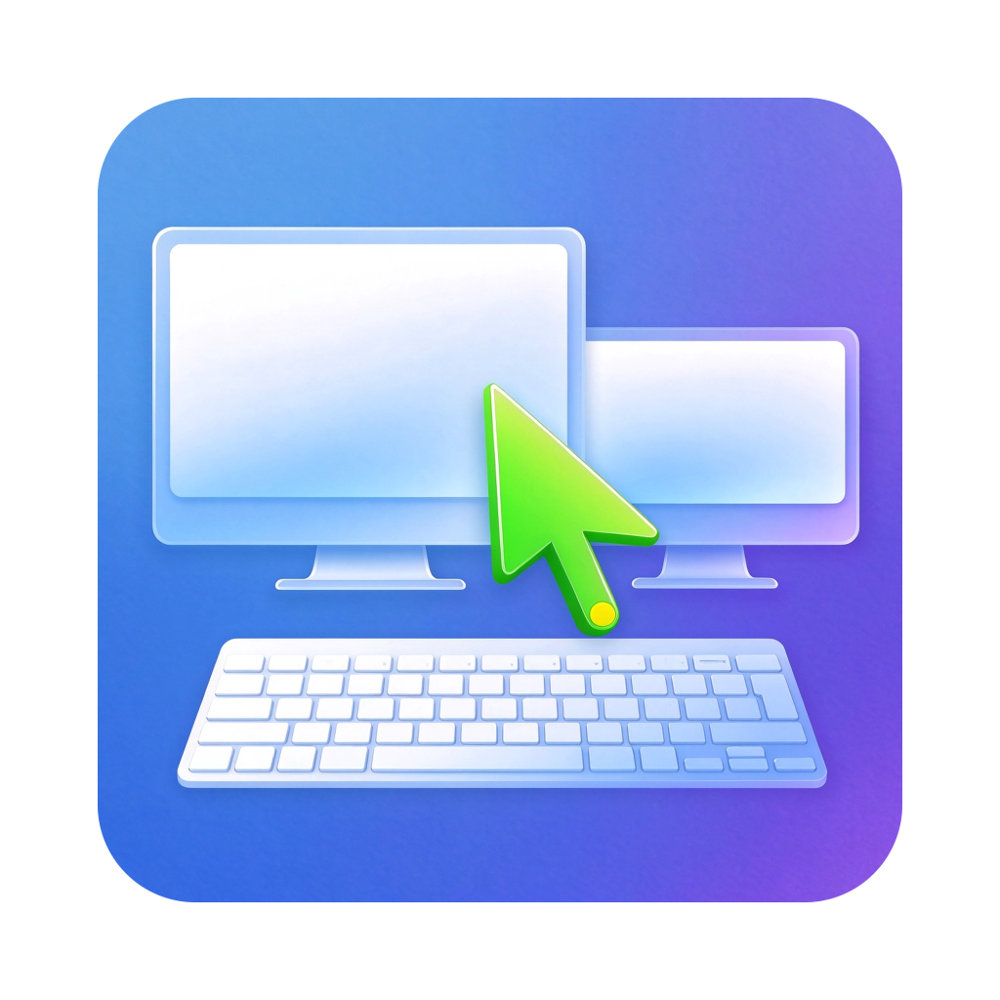

# mac-reconnect-wake

我平时用 Apple 的「通用控制」，让 iMac 和 Mac mini 共用一套键盘和鼠标。有时两台 Mac 都亮着，指针到了屏幕边缘却切不过去。有时 Mac mini 只是熄了屏，iMac 上的鼠标也没法把它点亮。我做了 **mac-reconnect-wake**，把这两种情况的处理入口放进菜单栏。

- **屏幕亮着，鼠标切不过去**：点「恢复连接」，让 macOS 重新尝试建立通用控制连接，也可以查看近期断链日志。
- **另一台 Mac 熄屏了**：在目标 Mac 仍在线时，点「点亮远程 Mac 屏幕」，按需输入密码，亮屏后再把指针推过去。

应用安装在连接键盘和鼠标的那台 Mac 上，支持 **macOS 13 及以上**，安装包同时包含 Intel 和 Apple 芯片版本。跨屏键鼠仍由 [Apple 通用控制](https://support.apple.com/zh-cn/102459) 提供，请先在两台 Mac 上完成系统设置。

## 可以做什么

| 菜单项 | 用途 |
| --- | --- |
| 恢复连接 | 请求重启本机当前用户的通用控制进程。连接仍未恢复时，可以打开显示器设置手动添加另一台 Mac。 |
| 点亮远程 Mac 屏幕 | 通过局域网 SSH 在目标 Mac 上执行 `caffeinate -u -t 5`。需要密码时弹出原生输入框，密码不会保存。 |
| 查看最近断链日志 | 按需读取本机统一日志最近 30 分钟的匹配记录，最多显示 6 条，便于和卡顿时间对照。应用不会另存日志。 |
| 打开显示器设置 | 从菜单栏直接打开 macOS 显示器设置。 |

只使用重连、日志和显示器设置时，可以跳过 SSH 配置。

## 安装与首次唤屏

1. 下载 Release 中的 `mac-reconnect-wake-macOS.zip`，解压后把应用拖到「应用程序」，再打开它。已有旧版时，先从菜单退出旧版。此版本使用临时签名，首次打开可能被 macOS 拦截。确认下载来源后，可通过「系统设置 → 隐私与安全性」查看是否提供「仍要打开」。也可以从源码自行构建。
2. 先在目标 Mac「系统设置 → 节能」开启「显示器关闭时防止自动睡眠」。唤屏需要目标 Mac 仍运行且能通过网络连接。
3. 在目标 Mac「系统设置 → 通用 → 共享」开启「远程登录」，访问权限选「仅这些用户」，添加你的账户。用这里显示的 SSH 地址确认短用户名及本地主机名或局域网 IPv4 地址。
4. 在控制端菜单中选择「设置唤屏目标…」，填写主机名或 IP、短用户名，以及可选的电脑显示名称。只使用重连、日志和显示器设置时可以跳过唤屏配置。
5. 点击「点亮远程 Mac 屏幕」。首次连接会提示检查主机指纹。在目标 Mac 的终端运行 `for key in /etc/ssh/ssh_host_*_key.pub; do ssh-keygen -lf "$key"; done`，核对 SHA256 指纹。完全一致后才点「指纹一致，继续」。如弹出登录密码框，输入目标 Mac 的登录密码。
6. 等目标显示器熄屏后再点一次，确认实体屏幕亮起，再试鼠标跨屏。如果只在长时间闲置后无法连接，检查目标 Mac 是否整机睡眠、掉线或换了 IP。

## 常见问题

**为什么填了 `.local` 主机名还是连不上？**  
如果局域网里解析不到这台 Mac，改填目标 Mac「系统设置 → 通用 → 共享 → 远程登录」显示的局域网 IPv4 地址。路由器重新分配地址后，记得更新应用里的唤屏目标。

**为什么没有出现首次指纹确认？**  
如果这台控制端 Mac 已经信任过该 SSH 主机，系统可以直接使用已有记录。若提示主机身份变化，请在目标 Mac 上核对指纹后再排查。

**点了唤屏，屏幕依然是黑的？**  
先看菜单状态，鼠标悬停菜单栏图标可以查看 SSH 返回的提示。确认目标 Mac 仍在线、远程登录已开启，并允许所填账户访问。这个功能针对显示器熄屏，整机睡眠后是否还能连接取决于目标 Mac 的电源和网络状态。屏幕点亮后如果停在锁屏界面，请照常解锁。

## 从源码构建

安装 Xcode 命令行工具后，在仓库目录运行 `./build.sh`。应用压缩包输出到 `dist/mac-reconnect-wake-macOS.zip`。发布时把该 ZIP 加到 GitHub Release 的附件。
